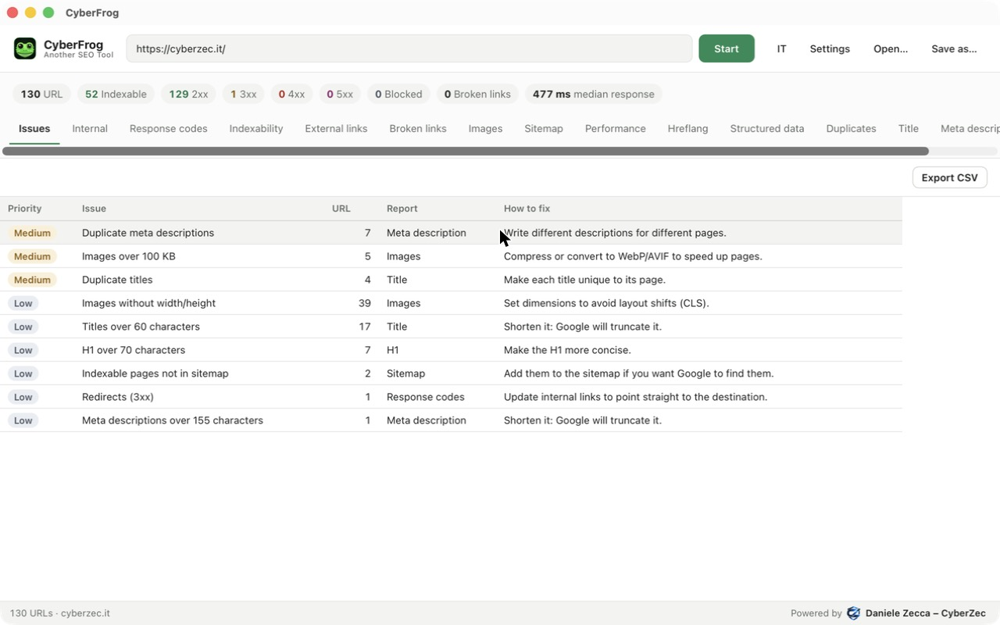

<p align="center">
  
</p>

<h1 align="center">CyberFrog – Another SEO Tool</h1>

<p align="center">
  A fast, open-source desktop SEO crawler for macOS.<br>
  Crawl a website, then read a prioritised list of what to fix.
</p>

<p align="center">
  
</p>

## Features

- **Sidebar of reports** grouped by Overview, Pages, Content, Links and Resources, each with a badge showing how many issue types it has.
- **Issues report**: every problem found, ranked High / Medium / Low, with the number of URLs affected and how to fix it. Click an issue to jump to the matching report, already filtered.
- **Crawling**: same-host breadth-first crawl, robots.txt (obeyed or ignored), redirects recorded, configurable speed, URL limit, user agent (CyberFrog, Googlebot, Bingbot or custom) and exclude patterns. Live progress, with a Stop button.
- **On-page**: titles, meta descriptions and H1 (missing, duplicate, too long, too short), word count, canonical, meta robots and X-Robots-Tag.
- **Indexability**: noindex/nofollow, canonicalised pages, canonicals pointing to non-200 URLs.
- **Links**: inlinks and outlinks with anchor text for every URL, external link checking, and broken links listed with the page they're on.
- **Images**: missing or empty alt text, missing width/height, file size (flagged above 100 KB).
- **XML sitemaps**: reads sitemap indexes from robots.txt, crawls sitemap-only URLs, finds orphan pages and indexable pages missing from the sitemap. It can also generate a `sitemap.xml`.
- **Performance**: response time and page size, median response time.
- **Hreflang**: invalid codes, missing return links, non-200 alternates, missing self-reference and x-default.
- **Structured data**: JSON-LD (including `@graph`) and microdata types, invalid JSON, missing properties Google requires for common rich results.
- **Duplicate content**: exact duplicates and near duplicates (SimHash, ≥ 90% similar) on the main content, plus low-content pages.
- **Crawl comparison**: compares each crawl with the previous one of the same site — new and removed pages, status and indexability changes, changed titles, meta descriptions, H1 and canonicals, and how each issue moved.
- **Custom extraction and search**: pull any value from every page with a CSS selector (text or attribute) or a regex — authors, prices, GA4 IDs — or check which pages contain or lack a piece of text or code.
- **Redirect chains**: every redirect followed to its final URL, with chains, loops and non-200 destinations.
- **Uncrawlable links**: links search engines may not follow (JavaScript navigation, `href` outside `<a>`) and invalid URLs.
- **Link Score and site structure**: internal PageRank on a 0–100 scale for every URL, URLs per click depth, and the folder tree with URL counts, indexable pages and the strongest Link Score in each folder.
- **JavaScript rendering** (optional): pages are also opened in a headless Chrome, Chromium, Brave or Edge already on your Mac. The JavaScript report shows content and links that exist only after rendering, and pages that failed to render.
- **AI assistant**: with your own Anthropic API key, Claude suggests titles and meta descriptions, explains a page's issues and writes a prioritised action plan for the whole crawl. The key stays in the macOS Keychain; page data is sent to Anthropic only when you ask.
- **MCP server**: Claude and other assistants can run crawls and query the data (see below).
- **Export and reuse**: CSV export of any view (Excel-friendly), crawls saved as single SQLite files you can save, reopen and query.
- **English and Italian** interface.


## Install

**macOS (Apple silicon):** download the `.dmg` from the [Releases](../../releases) page and drag CyberFrog to Applications.

### First launch on macOS

CyberFrog isn't notarised by Apple yet, so the first time macOS blocks it with *"Apple could not verify CyberFrog is free of malware"*. To allow it (once):

1. Open CyberFrog from Applications. When the warning appears, click **Done**.
2. Open **System Settings → Privacy & Security**, scroll to the **Security** section and click **Open Anyway** next to the CyberFrog message.
3. Confirm with **Open Anyway** and your password or Touch ID.

On macOS 14 (Sonoma) and earlier you can instead right-click the app and choose **Open**.

Prefer the Terminal? This removes the download quarantine flag:

```bash
xattr -dr com.apple.quarantine /Applications/CyberFrog.app
```

## Use with AI assistants (MCP)

CyberFrog includes a [Model Context Protocol](https://modelcontextprotocol.io) server, so assistants like Claude can crawl sites and analyse the results for you. Ask things like *"Crawl example.com and tell me what to fix first"* or *"Which pages have duplicate titles?"*.

**Claude Code:**

```bash
claude mcp add cyberfrog -- /Applications/CyberFrog.app/Contents/MacOS/cyberfrog --mcp
```

**Claude Desktop:** add this to `claude_desktop_config.json` (Settings → Developer → Edit Config):

```json
{
  "mcpServers": {
    "cyberfrog": {
      "command": "/Applications/CyberFrog.app/Contents/MacOS/cyberfrog",
      "args": ["--mcp"]
    }
  }
}
```

| Tool | What it does |
|---|---|
| `crawl_site` | Crawls a site (default limit 500 URLs) and returns an SEO summary; optional custom extraction/search rules and JavaScript rendering (`render_js`) |
| `list_crawls` | Lists saved crawls, newest first |
| `crawl_summary` | Status codes, indexability, title/meta/H1 problems, broken links, slow pages, images |
| `query_crawl` | Runs a read-only SQL `SELECT` on a crawl (up to 200 rows) |
| `page_details` | Metadata, inlinks and outlinks of one URL |

Crawls made through MCP are saved alongside the app's crawls, so you can open them in CyberFrog too.

## Build from source

Requirements: [Node.js](https://nodejs.org) 20+, [Rust](https://rustup.rs) 1.88+, Xcode Command Line Tools.

```bash
npm install
npm run tauri dev          # run in development
npx tauri build            # build CyberFrog.app and the .dmg
```

Crawl from the terminal without the UI:

```bash
cd src-tauri
cargo run --example crawl -- https://example.com crawl.sqlite
```

Tests:

```bash
cd src-tauri && cargo test     # crawler, reports, settings
node scripts/pages.check.ts    # filters, issues and exports
```

## How it works

| Part | Technology |
|---|---|
| Desktop shell | [Tauri 2](https://tauri.app) |
| Crawler | Rust: tokio, reqwest, scraper, texting_robots; optional headless Chromium for JavaScript |
| AI assistant | Claude Messages API, key in the macOS Keychain |
| Storage | one SQLite file per crawl |
| Interface | React + TypeScript, TanStack Table and Virtual |

The crawler writes every URL, link, image and structured-data item to SQLite while it runs. The reports read from that file, so a crawl can be closed, reopened or shared later.

## Be a good citizen

Crawl sites you own or have permission to audit. Keep the default speed unless you know the server can take more, and leave "Respect robots.txt" on.

## Not affiliated with Screaming Frog

CyberFrog is an independent, clean-room project inspired by desktop SEO crawlers such as Screaming Frog SEO Spider. It contains no code, assets or data from Screaming Frog, and was written only from public documentation and observable behaviour. "Screaming Frog" and "SEO Spider" are trademarks of their respective owner.

## License

[Apache License 2.0](LICENSE). If you redistribute CyberFrog or a modified version, keep the [NOTICE](NOTICE) file with the attribution to the author and state the changes you made.

---

<p align="center">
  Powered by <a href="https://cyberzec.it"><strong>Daniele Zecca – CyberZec</strong></a>
</p>
