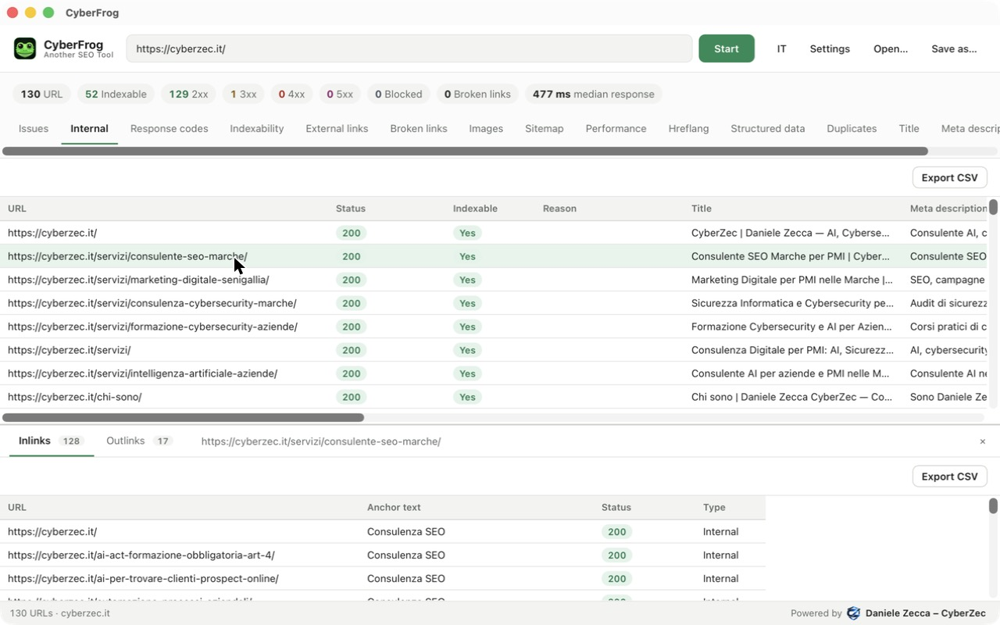
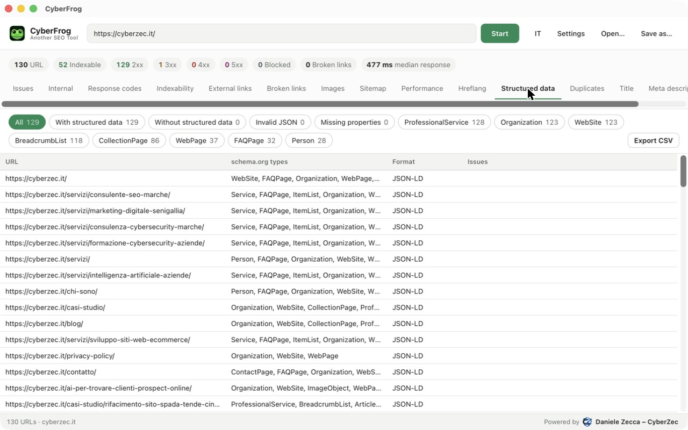

<p align="center">
  
</p>

<h1 align="center">CyberFrog – Another SEO Tool</h1>

<p align="center">
  A fast, open-source desktop SEO crawler for macOS.<br>
  Crawl a website, then read a prioritised list of what to fix.
</p>

<p align="center">
  
</p>

## Features

- **Issues report**: every problem found, ranked High / Medium / Low, with the number of URLs affected and how to fix it. Click an issue to jump to the matching report, already filtered.
- **Crawling**: same-host breadth-first crawl, robots.txt (obeyed or ignored), redirects recorded, configurable speed, URL limit, user agent (CyberFrog, Googlebot, Bingbot or custom) and exclude patterns. Live progress, with a Stop button.
- **On-page**: titles, meta descriptions and H1 (missing, duplicate, too long, too short), word count, canonical, meta robots and X-Robots-Tag.
- **Indexability**: noindex/nofollow, canonicalised pages, canonicals pointing to non-200 URLs.
- **Links**: inlinks and outlinks with anchor text for every URL, external link checking, and broken links listed with the page they're on.
- **Images**: missing or empty alt text, missing width/height, file size (flagged above 100 KB).
- **XML sitemaps**: reads sitemap indexes from robots.txt, crawls sitemap-only URLs, finds orphan pages and indexable pages missing from the sitemap. It can also generate a `sitemap.xml`.
- **Performance**: response time and page size, median response time.
- **Hreflang**: invalid codes, missing return links, non-200 alternates, missing self-reference and x-default.
- **Structured data**: JSON-LD (including `@graph`) and microdata types, invalid JSON, missing properties Google requires for common rich results.
- **Duplicate content**: exact duplicates and near duplicates (SimHash, ≥ 90% similar) on the main content, plus low-content pages.
- **Export and reuse**: CSV export of any view (Excel-friendly), crawls saved as single SQLite files you can save, reopen and query.
- **English and Italian** interface.

<p align="center">
  
</p>
<p align="center">
  
</p>

## Install

**macOS (Apple silicon):** download the `.dmg` from the [Releases](../../releases) page and drag CyberFrog to Applications.

The app isn't notarised by Apple yet. The first time you open it, right-click the app and choose **Open**.

## Build from source

Requirements: [Node.js](https://nodejs.org) 20+, [Rust](https://rustup.rs) 1.88+, Xcode Command Line Tools.

```bash
npm install
npm run tauri dev          # run in development
npx tauri build            # build CyberFrog.app and the .dmg
```

Crawl from the terminal without the UI:

```bash
cd src-tauri
cargo run --example crawl -- https://example.com crawl.sqlite
```

Tests:

```bash
cd src-tauri && cargo test     # crawler, reports, settings
node scripts/pages.check.ts    # filters, issues and exports
```

## How it works

| Part | Technology |
|---|---|
| Desktop shell | [Tauri 2](https://tauri.app) |
| Crawler | Rust: tokio, reqwest, scraper, texting_robots |
| Storage | one SQLite file per crawl |
| Interface | React + TypeScript, TanStack Table and Virtual |

The crawler writes every URL, link, image and structured-data item to SQLite while it runs. The reports read from that file, so a crawl can be closed, reopened or shared later.

## Be a good citizen

Crawl sites you own or have permission to audit. Keep the default speed unless you know the server can take more, and leave "Respect robots.txt" on.

## Not affiliated with Screaming Frog

CyberFrog is an independent, clean-room project inspired by desktop SEO crawlers such as Screaming Frog SEO Spider. It contains no code, assets or data from Screaming Frog, and was written only from public documentation and observable behaviour. "Screaming Frog" and "SEO Spider" are trademarks of their respective owner.

## License

[Apache License 2.0](LICENSE). If you redistribute CyberFrog or a modified version, keep the [NOTICE](NOTICE) file with the attribution to the author and state the changes you made.

---

<p align="center">
  Powered by <a href="https://cyberzec.it"><strong>Daniele Zecca – CyberZec</strong></a>
</p>
